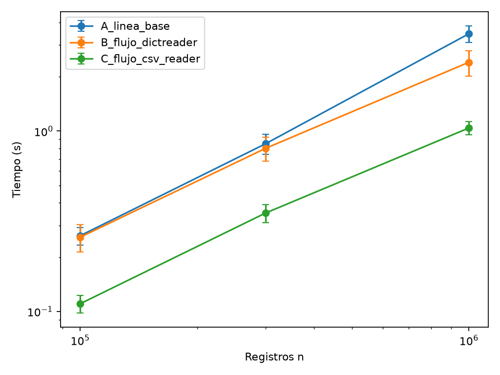
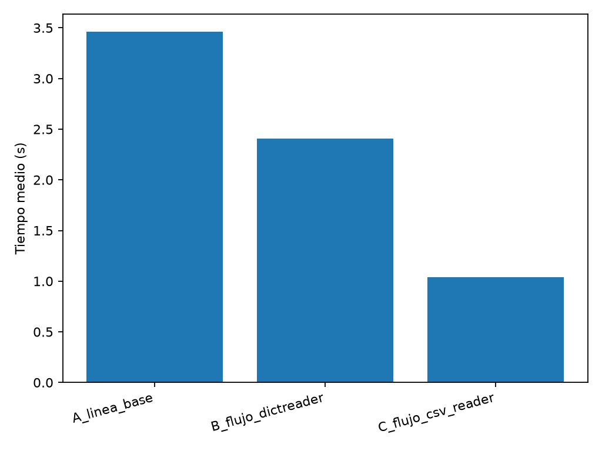

# Informe científico breve — Equipo 1

**Título:** Comparación del procesamiento de ventas por región · **Integrantes:** Jhostyn, Steven y Liney · **Fecha:** 2026-11-18 · **Repositorio:** LogiAndes-S.A.S.

## Resumen
Se compararon tres métodos para totalizar ventas en seis regiones con archivos de 100 000, 300 000 y 1 000 000 de filas. La corrida formal de entrega tuvo diez mediciones de tiempo por estrategia y tamaño y mediciones de memoria separadas. Para un millón de filas, C (`csv.reader` en flujo) promedió 1.0400 s frente a 3.4624 s de A, una reducción de 70.0 %. Las tres estrategias devolvieron los mismos totales. El CV de tiempo quedó entre 11.5 % y 23.7 %, por encima del umbral del 10 %; los resultados indican una ventaja de C, pero su variabilidad limita la generalización.

## 1. Introducción
El caso simulado representa un archivo de ventas de más de un millón de filas. Se compararon tiempo y memoria al variar el método de procesamiento. El trabajo computacional se relaciona con operaciones y ciclos aproximados por N = f·t. Los datos se transfieren desde almacenamiento a RAM y CPU, y el rendimiento de lectura depende de la tasa efectiva en MB/s. E = P̄·t; no se afirma ahorro energético porque no hubo mediciones RAPL válidas.

## 2. Hipótesis
Las hipótesis H1–H3 se conservaron según el protocolo. A n = 1 000 000, las estimaciones puntuales cumplen los umbrales: A→B reduce el tiempo 30.5 % y la memoria trazada 99.97 %; B→C reduce el tiempo 56.8 %. La memoria tiene una corrida separada por estrategia/tamaño y el CV de tiempo supera el criterio de calidad, así que estos resultados no demuestran por sí solos reproducibilidad estable.

## 3. Método
A materializa una lista de diccionarios y vuelve a recorrerla por región; B suma una pasada con `DictReader`; C suma una pasada con `csv.reader` e índices de columnas. Se usó la misma semilla/datos y un orden aleatorio con semilla 42. El protocolo precalentó los archivos, por lo que los tiempos representan principalmente acceso con caché caliente. La corrida formal contiene diez tiempos por combinación y una corrida de memoria separada por combinación.

## 4. Resultados
Las cifras de esta sección se calcularon desde `resultados/medicion_formal_local.csv`; el resumen correspondiente está en `resultados/resumen.csv`. Las dos series anteriores se conservan por separado en `resultados/resultados.csv`, `resultados/repeticion_2.csv` y `resultados/consolidado.csv`.

| n | Estrategia | Media (s) | SD (s) | CV (%) | IC95 % (s) |
|---:|---|---:|---:|---:|---:|
| 100 000 | A | 0.2627 | 0.0403 | 15.3 | [0.2333, 0.2921] |
| 100 000 | B | 0.2577 | 0.0611 | 23.7 | [0.2132, 0.3023] |
| 100 000 | C | 0.1102 | 0.0168 | 15.3 | [0.0979, 0.1225] |
| 300 000 | A | 0.8503 | 0.1484 | 17.5 | [0.7421, 0.9586] |
| 300 000 | B | 0.8020 | 0.1654 | 20.6 | [0.6814, 0.9227] |
| 300 000 | C | 0.3511 | 0.0551 | 15.7 | [0.3110, 0.3913] |
| 1 000 000 | A | 3.4624 | 0.4923 | 14.2 | [3.1034, 3.8214] |
| 1 000 000 | B | 2.4070 | 0.5307 | 22.0 | [2.0200, 2.7940] |
| 1 000 000 | C | 1.0400 | 0.1201 | 11.5 | [0.9524, 1.1276] |

En la corrida separada de memoria para un millón de filas: A = 529.310 MiB, B = 0.182 MiB y C = 0.176 MiB (`tracemalloc`; una medición por estrategia). `tracemalloc` mide asignaciones de Python, no el RSS total. No se obtuvieron valores válidos de energía RAPL.

## 5. Discusión
Las estimaciones respaldan la dirección prevista: menos recorridos y menos objetos temporales coincidieron con menor tiempo y memoria trazada. En el millón de filas, C fue aproximadamente 3.33 veces más rápida que A. Sin embargo, todas las combinaciones tuvieron CV > 10 %. El CV no prueba un defecto del código, pero señala que la carga del sistema, la frecuencia u otras condiciones no registradas pudieron afectar las mediciones. Los IC95 % son descriptivos y pueden subestimar la incertidumbre si hubo deriva durante la sesión. La corrida se hizo en escenario principalmente de caché caliente.

## 6. Propuesta de mejora para la empresa
Probar C como prototipo para el escenario de caché caliente, verificando totales contra la línea base. Antes de producción, repetir en condiciones controladas y registrar la carga/frecuencia del sistema; realizar también una evaluación de lectura fría separada. No extrapolar el ahorro de memoria a la memoria total ni afirmar ahorro de energía con estos datos.

## 7. Conclusiones
C mostró la menor media de tiempo en los tres tamaños y una reducción estimada de 70.0 % frente a A a un millón de filas. La ventaja observada es prometedora, pero el CV excedió el criterio del protocolo; las conclusiones quedan condicionadas a mediciones más estables.

## 8. Referencias
Documentación de Python para los módulos `csv`, `time`, `tracemalloc` y `statistics`.

## Anexo: uso de IA
Ver `docs/uso_ia.md`; el equipo debe verificar resultados y explicar las decisiones sin ayuda.
